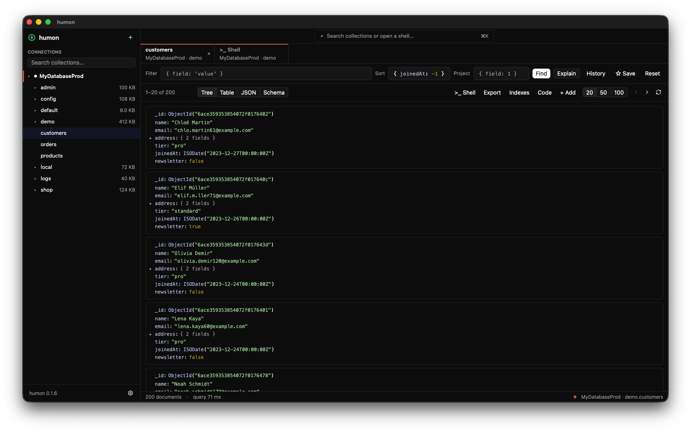
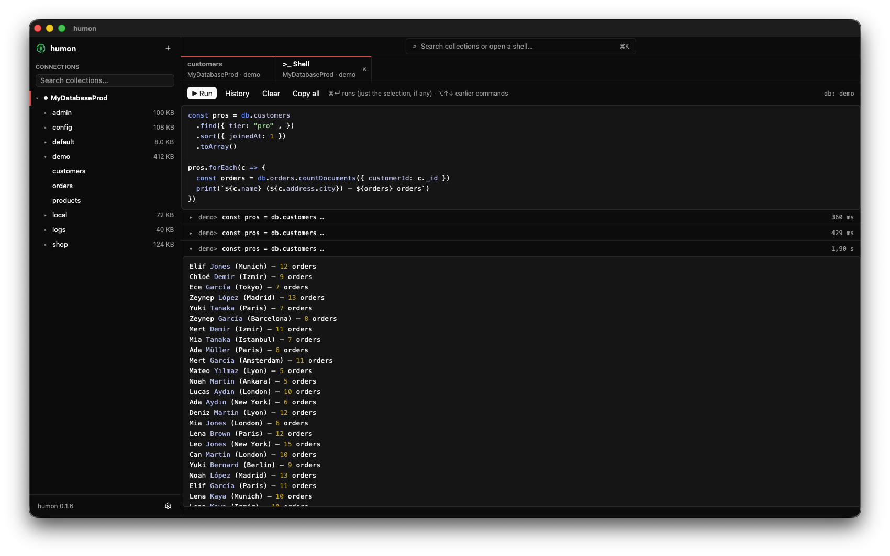

<p align="center">
  
</p>

<h1 align="center">humon</h1>

<p align="center">
  A small, fast MongoDB client for your desktop.<br>
  Written in Rust, drawn with <a href="https://www.gpui.rs">gpui</a>. No browser inside.
</p>

<p align="center">
  <a href="https://github.com/yldrmzffr/humon/releases/latest"></a>
  <a href="https://github.com/yldrmzffr/humon/actions/workflows/ci.yml"></a>
  
  <a href="LICENSE"></a>
</p>

<p align="center">
  
</p>

## Why humon?

- **Native, GPU-drawn UI.** No browser and no Electron inside, so it opens instantly
  and stays responsive with large results.
- **Small memory footprint.** Results are streamed, paged and exported straight to
  disk instead of being held in memory.
- **One small app.** A single binary with an embedded JavaScript shell: no Node.js,
  no mongosh, nothing else to install.

## Install

With [Homebrew](https://brew.sh):

```sh
brew install --cask yldrmzffr/tap/humon
```

Or download the latest `.dmg` from
[Releases](https://github.com/yldrmzffr/humon/releases/latest), open it and drag humon
into Applications. It runs on Apple Silicon and Intel Macs (macOS 12 or newer).

The app is not notarized by Apple yet, so the first launch is blocked with a warning.
Open **System Settings → Privacy & Security** and click **Open Anyway** (once), or run:

```sh
xattr -dr com.apple.quarantine /Applications/humon.app
```

humon shows a notice in the sidebar when a new version is out (`brew upgrade`
installs it).

## Features

**Connect**
- Any connection string, including Atlas (`mongodb+srv://`) and compressed
  connections (`compressors=zlib`, `zstd`, `snappy`)
- Saved connections, each with a color its tabs share; passwords in the Keychain

**Browse**
- Connections → databases → collections, with a quick collection search
- Quick open (⌘K): jump to any collection or a database's shell by typing,
  e.g. `users`, `shop.ord` or `>_ logs`
- Tabs, including the same collection twice. Open tabs come back on the next
  launch with their queries, views and shell scripts, and reconnect on their own

**Query**
- Filter, sort and project in mongo shell syntax:
  `{ _id: ObjectId("…"), createdAt: { $gt: ISODate("2024-01-01") } }`
- Suggestions as you type: field names with their types and how often they appear,
  operators that fit each field (every operator, from MongoDB's own specifications,
  with its docs link), and values like `1`/`-1` for sort
- Warnings as you type: unknown fields (with a "did you mean"), unknown operators,
  values of the wrong type for a field, malformed operator arguments
- Fields are learned from a sample of the collection; then the server is asked for
  documents that don't fit it, until none are left, so rare fields and types are
  found too, and a warning can say a field exists nowhere. The sample size and the
  search are in Settings
- Tree, table, JSON and Schema views. The JSON view can be selected, copied and
  searched; the Schema view shows every field, how often it appears and its types
- Explain: whether the query used an index or read the whole collection, and how many
  documents and keys it read to return how many
- Indexes: list them, create one (with field completion), drop one
- The query as driver code for Node.js, Python, Go, Java or Rust
- Query history and favorites for every collection
- Export to JSON or CSV, streamed to disk so big exports stay light

**Edit**
- Edit, clone, copy, delete and insert documents in a colored editor
- Create, rename and drop databases and collections (drops ask you to type the name)
- Helpful typing: brackets close themselves, `Obj` becomes `ObjectId("")`,
  and pasted ids, UUIDs and dates are wrapped for you

**Shell**

<p align="center">
  
</p>

- A built-in shell like Studio 3T's IntelliShell: write a script, run it, and read
  each run in its own block, ready to copy, run again or fold away
- mongosh-style JavaScript on an embedded QuickJS engine:

  ```js
  use shop
  db.users.find({ age: { $gte: 30 } }).sort({ age: -1 }).limit(5)
  db.orders.aggregate([{ $group: { _id: "$status", n: { $sum: 1 } } }])
  db.users.find({ city: "Izmir" }).forEach(u => print(u.name))
  ```

- Completion for databases, collections, methods, and the collection's fields and
  operators inside `find`, `aggregate` and `update…`. In a pipeline, later stages see
  the fields earlier ones produce
- The same warnings as the query boxes, in every query in the script
- Most mongosh collection and cursor methods, `it` for the next page, and the shell
  types (`ObjectId`, `ISODate`, `UUID`, …)

**And**
- English, Turkish, Spanish, French, Chinese (Simplified), Hindi and Arabic. Arabic
  text shows, but the layout stays left to right

## Keyboard shortcuts

| Keys | Where | Does |
| --- | --- | --- |
| ⌘K | anywhere | Quick open a collection or shell |
| ↑ ↓ Enter Esc | completion menu, quick open | Pick, use, close |
| ⌘-click, middle-click | collection in the sidebar | Open in a new tab |
| middle-click | tab | Close the tab |
| Enter | filter, sort, project | Run the query |
| ⌘↵ | shell | Run the script, or just the selection |
| ⌥↑ ⌥↓ | shell | Earlier and later commands |
| ⌘↵ | document editor | Save |
| ⌘F | shell results, JSON view | Search |

## Your data and privacy

- **Passwords are kept in the macOS Keychain**, under `dev.muzaffer.humon`. The rest
  of each connection (name, color, and the connection string without its password)
  is in `~/Library/Application Support/dev.muzaffer.humon/connections.json`,
  readable only by your user.
- Because humon isn't signed yet, macOS may ask to let it use the Keychain after an
  update; choose "Always Allow". The Keychain protects passwords at rest, not on a
  machine someone else already controls.
- The same folder holds `history.json` (recent and favorite queries), `settings.json`
  and `session.json` (the open tabs, their queries and shell scripts).
- To learn a collection's fields, humon reads a sample of it and, unless turned off,
  runs a few queries for documents that don't fit the sample. Those can't use an
  index, so each is limited to 5 seconds and all of them to 20. To spare a busy
  server, make the sample smaller or turn the search off in Settings.
- humon makes one network request of its own: on start it asks GitHub for the latest
  release, to show the update notice. Turn it off in Settings.

## Built entirely by AI

Every line of code in this repo was written by an AI ([Claude](https://claude.com/claude-code)),
with a human giving directions, testing, and saying "no, not like that" a lot.
That includes this README. Treat it as an experiment: it works well for me,
but read the code before you trust it with anything important.

## Contributing

Bugs, ideas and pull requests are welcome: [open an issue](https://github.com/yldrmzffr/humon/issues).
[CONTRIBUTING.md](CONTRIBUTING.md) covers tests, releases and how the code is laid
out; [CHANGELOG.md](CHANGELOG.md) says what changed in each version.

**Build from source.** You need [Rust](https://rustup.rs) 1.88+ and macOS (Linux and
Windows builds are planned):

```sh
cargo run --release
./scripts/bundle-macos.sh && open target/release/humon.app   # an app with a Dock icon
```

**Add your language.** All text is in `locales/`, one file per language: copy
`locales/en.yml` to `locales/<code>.yml`, translate the values (including
`_language_name`, keeping `%{...}` as it is), and run `cargo test --release`, which
tells you if anything is missing. No code changes; it shows up in Settings.

## To do

- [ ] Tab menu: duplicate, close others (and ⌘D)
- [ ] More shortcuts: ⌘T, ⌘W, ⌘1–9, ⌘R
- [ ] Read-only connections, so production can't be changed by accident
- [ ] Aggregation pipeline editor with stage previews
- [ ] Edit a single field without opening the whole document
- [ ] Update or delete many documents by filter (with confirmation)
- [ ] Import from JSON / CSV
- [ ] SSH tunnel and TLS certificate options
- [ ] Notarized macOS releases (no first-launch warning), then the main Homebrew repo
- [ ] Linux and Windows builds
- [ ] UI-level tests with gpui's test harness

## Thanks

- [Jérôme Tamarelle (@GromNaN)](https://github.com/GromNaN)

## License

[MIT](LICENSE). The operator definitions in `src/mql/spec.rs` are generated from
MongoDB's [MQL specifications](https://github.com/mongodb/mql-specifications)
([Apache-2.0](third_party/mql-specifications/LICENSE)) by `scripts/gen-mql.rb`.
